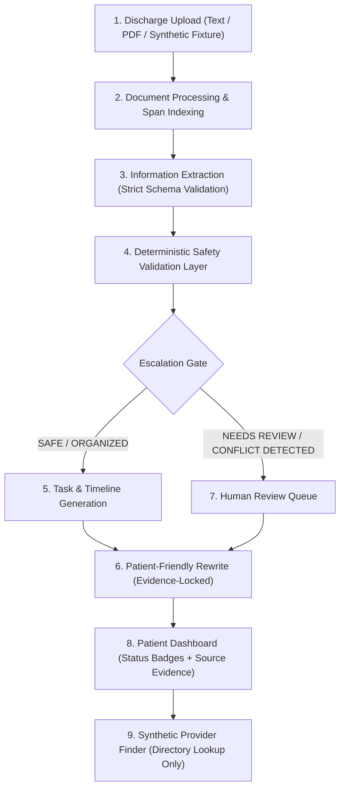

# CAREBRIDGE: Agentic Hospital Discharge & Follow-up Coordinator

## 1. Executive Summary & Clinical Safety Mandate

CAREBRIDGE transforms unstructured, dense hospital discharge summaries into structured, patient-friendly, and trackable follow-up plans while maintaining strict clinical safety boundaries.

### Non-Negotiable Clinical Guardrails
CAREBRIDGE is a **coordination and organization engine**, NOT a clinical decision maker. The system is strictly prohibited from:
1. **Diagnosing** medical conditions or interpreting lab/imaging results.
2. **Prescribing** new medications or therapies.
3. **Changing medications** (altering doses, frequencies, or routes not explicitly written in the discharge text).
4. **Recommending treatments** beyond organizing what the discharging clinician explicitly documented.
5. **Inventing missing information** (e.g., guessing a follow-up timeframe, specialty, or dosage when omitted).
6. **Guaranteeing provider suitability or availability** (all provider matches are unverified synthetic directory suggestions requiring patient/clinician confirmation).

Any clinically sensitive, ambiguous, conflicting, unsupported, or incomplete instruction is deterministically intercepted by the **Safety Validation Layer** and escalated to **HUMAN REVIEW**.

---

## 2. System Architecture & Data Pipeline



### Pipeline Stages
1. **Discharge Upload & Document Processing**: Normalizes raw text, segments paragraphs/sections, and assigns character offsets, line numbers, and page/section identifiers so every downstream item can point to exact source evidence.
2. **Information Extraction**: Extracts structured entities (`MedicationInstruction`, `FollowUpInstruction`, `WarningSign`, `ActivityOrDietInstruction`, `PendingTestOrLab`) constrained by strict Pydantic/TypeScript schemas. Never trusts raw LLM output—every field is schema-validated.
3. **Safety Validation Layer**: A deterministic, rule-driven clinical safety engine sitting between extraction and patient-facing output. It audits extracted items AND raw source text for 10+ hazard classes:
   - Missing follow-up timeframe (`MISSING_FOLLOWUP_TIMEFRAME`)
   - Missing specialty (`MISSING_SPECIALTY`)
   - Ambiguous medication instructions (`AMBIGUOUS_MEDICATION_INSTRUCTION`)
   - Medication changes (`MEDICATION_CHANGE_DETECTED`)
   - Stop/start medication instructions (`STOP_START_MEDICATION`)
   - Unclear dosage (`UNCLEAR_DOSAGE`)
   - Conflicting instructions (`CONFLICTING_INSTRUCTIONS`)
   - Unclear symptoms (`UNCLEAR_SYMPTOMS`)
   - Warning-sign escalation (`WARNING_SIGN_ESCALATION`)
   - Unsupported provider claims (`UNSUPPORTED_PROVIDER_CLAIM`)
   - Missing source evidence (`MISSING_SOURCE_EVIDENCE`)
   - Prohibited clinical advice / hallucination guard (`PROHIBITED_CLINICAL_ACTION`)
4. **Task/Timeline Generation**: Converts validated instructions into trackable checklist items ordered chronologically, clearly badged by safety status (`SAFE_ORGANIZED`, `NEEDS_REVIEW`, `CONFLICT_DETECTED`).
5. **Patient-Friendly Rewrite**: Plain-language explanation locked to the extracted facts. Cannot introduce numbers, dosages, timeframes, or clinical claims absent from the source span.
6. **Human Review Queue**: Displays flagged items with side-by-side raw source evidence and specific hazard codes for clinician or care-coordinator sign-off.
7. **Patient Dashboard & Synthetic Provider Finder**: Interactive UI presenting the care plan with explicit visual distinction between `SAFE / ORGANIZED`, `NEEDS REVIEW`, `CONFLICT DETECTED`, and `SOURCE EVIDENCE`, plus a clearly disclaimed synthetic provider directory filtered by specialty and location.

---

## 3. Repository Structure

```text
submission_package/
├── backend/
│   ├── __init__.py
│   ├── main.py                  # FastAPI application entrypoint
│   ├── schemas/
│   │   ├── __init__.py
│   │   └── models.py            # Core Pydantic v2 schemas & enums
│   ├── safety/
│   │   ├── __init__.py
│   │   └── validator.py         # Deterministic Safety Validation Engine
│   └── fixtures/
│       ├── __init__.py
│       └── discharge_cases.py   # Synthetic normal, incomplete, ambiguous, conflicting, unsafe cases
├── frontend/
│   ├── package.json
│   ├── tsconfig.json            # Strict TypeScript configuration
│   └── src/
│       └── types/
│           └── schema.ts        # Strict TypeScript interfaces mirroring Pydantic models
├── tests/
│   ├── __init__.py
│   ├── test_schemas.py          # Unit & boundary tests for strict Pydantic validation
│   └── test_safety_validator.py # Comprehensive tests for all 10+ clinical hazard detectors
└── docs/
    └── architecture.md          # Architecture, failure modes, and testing strategy
```

---

## 4. Likely Failure Points & Mitigations

| Failure Mode | Clinical / Product Risk | Engineering Mitigation |
| :--- | :--- | :--- |
| **LLM Hallucination / Fabricated Details** | Model invents a "2 weeks" follow-up or "50mg" dose when missing in source text. | Schema permits `None` ("unknown") for missing fields; validator verifies that every non-null extracted value has a verbatim `source_evidence.quote` substring present in the raw discharge document. |
| **Silent Medication Conflicts** | Summary body says "Continue Lisinopril 10mg" while Medication List says "STOP Lisinopril". | Cross-item & intra-document conflict detector compares normalized drug names across instructions and flags `CONFLICTING_INSTRUCTIONS` + `CONFLICT_DETECTED` status. |
| **Unflagged Dose Changes / Stop-Start** | High-risk transitions (e.g., "Increase Furosemide from 20mg to 40mg", "Hold Eliquis for 3 days") passed through without review. | Explicit lexical + structural detector flags `MEDICATION_CHANGE_DETECTED` and `STOP_START_MEDICATION`, elevating review status to `NEEDS_REVIEW`. |
| **Vague Warning Signs vs. Acute Red Flags** | "Call if feeling worse" (unclear) or "Chest pain / shortness of breath" (critical red flag) mishandled. | Differentiates `UNCLEAR_SYMPTOMS` (vague phrasing) from `WARNING_SIGN_ESCALATION` (urgent/emergent symptoms requiring immediate emergency escalation notice). |
| **Overpromising Provider Matches** | System claims a doctor is "the best cardiologist" or "has an appointment tomorrow". | Validator scans provider claims and rewrites for availability/suitability guarantees (`UNSUPPORTED_PROVIDER_CLAIM`) and enforces a mandatory non-endorsement disclaimer. |
| **Low-Confidence Extraction** | Ambiguous OCR or convoluted clinical shorthand extracted with `< 0.80` confidence. | Automatic escalation to `NEEDS_REVIEW` whenever `confidence < 0.80` or `source_evidence.quote` is empty/unverified. |

---

## 5. Testing Strategy

We follow a strict **Incremental Test-Driven Verification** workflow:
1. **Schema Contract Tests (`tests/test_schemas.py`)**:
   - Verify valid data serialization/deserialization.
   - Intentionally feed malformed types, out-of-range confidences (`<0` or `>1`), empty evidence strings, and extra unpermitted fields (`extra="forbid"`) to prove strict rejection.
2. **Hazard Detection & Safety Validation Tests (`tests/test_safety_validator.py`)**:
   - Test all 5 canonical synthetic fixtures (**Normal**, **Incomplete**, **Ambiguous**, **Conflicting**, **Unsafe / Prohibited**).
   - Verify each of the 10 mandatory safety detection categories triggers the exact `HazardCode` and transitions the item/plan state to `NEEDS_REVIEW` or `CONFLICT_DETECTED`.
3. **Adversarial & Red-Team Edge Cases**:
   - Fabricated source quote (quote does not exist in raw document text) -> must fail verification and trigger `MISSING_SOURCE_EVIDENCE`.
   - Subtle contradiction (same medication listed twice with different doses or actions).
   - Attempted diagnostic or prescriptive statement in patient-friendly summary -> blocked by `PROHIBITED_CLINICAL_ACTION`.
4. **Static Analysis & Type Checking**:
   - Python: `pytest`, syntax/import compilation, and strict Pydantic v2 validation.
   - TypeScript: strict `tsc --noEmit` verification when Node/TypeScript toolchain is available.
